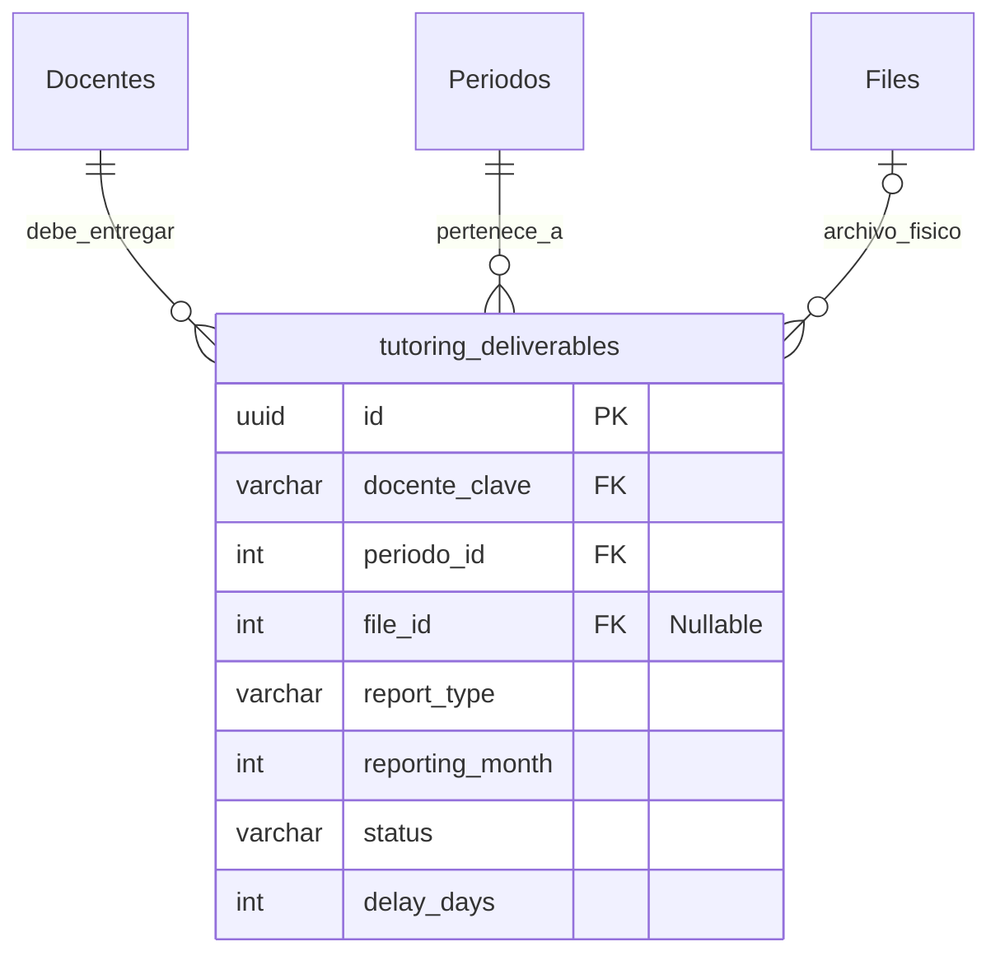

# Especificación de Base de Datos: Módulo de Cumplimiento Docente (Compliance)

## 1. Contexto y Objetivo
* **Módulo:** `Compliance` (Cumplimiento Docente).
* **Objetivo:** Gestionar y auditar la entrega de los 7 reportes obligatorios de tutorías por parte de los 54 docentes, aplicando reglas de tiempo (días 5 al 10) y registrando el nivel de cumplimiento y mora.
* **Estrategia Relacional:** No se alterará la tabla heredada `Files` con lógica de tutorías. `Files` se usará estrictamente como almacén binario. Se creará una nueva tabla de dominio `tutoring_deliverables` (Entregables de Tutoría) que actuará como puente lógico entre `Docentes`, `Periodos` y `Files`.

## 2. Diagrama Entidad-Relación (Modelo Extendido)

## 3. Diccionario de Datos: `tutoring_deliverables`
Esta tabla implementa los 10 campos de auditoría inmutable (`Soft Delete`) requeridos por la arquitectura base del TecNM.

| Columna | Tipo (PostgreSQL) | Regla / Constraint | Descripción |
| :--- | :--- | :--- | :--- |
| `id` | `uuid` | **PK**, Default `gen_random_uuid()` | Identificador único del entregable. |
| `docente_clave` | `varchar` | **FK** ➜ `Docentes.Clave` | Clave oficial del maestro/tutor. |
| `periodo_id` | `int` | **FK** ➜ `Periodos.PeriodoID` | Semestre/Periodo al que corresponde la entrega. |
| `file_id` | `int` | **FK** ➜ `Files.ID`, `NULLABLE` | Referencia al archivo binario cargado (si ya se entregó). |
| `report_type` | `varchar(32)` | `NOT NULL` | Tipo de anexo (Ver catálogo de tipos abajo). |
| `reporting_month` | `smallint` | `CHECK (1 TO 12)` | Mes calendario al que corresponde el reporte (ej. 2 para Febrero). |
| `status` | `varchar(16)` | `DEFAULT 'Pending'` | Estado: `Pending`, `OnTime`, `Late`. |
| `delay_days` | `int` | `DEFAULT 0` | Días de retraso acumulados después del día 10 del mes de entrega. |
| `created_at` | `timestamptz` | `DEFAULT CURRENT_TIMESTAMP` | (Auditoría) Fecha de creación del registro. |
| `created_by` | `varchar(254)` | `NOT NULL` | (Auditoría) Usuario que creó el registro (Sistema o Docente). |
| `created_ip` | `varchar(45)` | `NOT NULL` | (Auditoría) IP de origen. |
| `updated_at` | `timestamptz` | `NULLABLE` | (Auditoría) Fecha de última modificación. |
| `updated_by` | `varchar(254)` | `NULLABLE` | (Auditoría) Usuario que modificó. |
| `updated_ip` | `varchar(45)` | `NULLABLE` | (Auditoría) IP de modificación. |
| `is_deleted` | `boolean` | `DEFAULT false` | (Auditoría - Soft Delete) Control de borrado lógico. |
| `deleted_at` | `timestamptz` | `NULLABLE` | (Auditoría) Fecha de eliminación. |
| `deleted_by` | `varchar(254)` | `NULLABLE` | (Auditoría) Usuario que eliminó. |
| `deleted_ip` | `varchar(45)` | `NULLABLE` | (Auditoría) IP de eliminación. |

## 4. Catálogos y Constantes de Negocio (Enums de C#)
El campo `report_type` solo aceptará los siguientes valores exactos en la validación de Entity Framework Core:
1. `PlanTrabajo` (Plan de Trabajo 16 Sesiones - Semestral)
2. `DiagnosticoInicial` (Diagnóstico del grupo - Semestral)
3. `Anexo14` (Trayectoria Académica - Mensual)
4. `Anexo15` (Desempeño Académico - Mensual)
5. `Anexo19AMensual` (Reporte Mensual del Tutor - Mensual)
6. `Asistencia` (Lista de Asistencia - Mensual)
7. `Anexo19Final` (Reporte Semestral - Semestral)

## 5. Reglas de Negocio (Fat Services)
1. **Inicialización de Semestre:** Al inicio de un `PeriodoID`, un proceso en segundo plano (Background Worker) insertará automáticamente registros en `tutoring_deliverables` con `status = 'Pending'` para todos los docentes activos, generando las tareas esperadas para el periodo.
2. **Validación de Ventana de Tiempo (Upload):** 
    * El método de carga evaluará `DateTime.UtcNow.Day`.
    * Si se sube entre el día 5 y el 10 del mes: se enlaza el `file_id` y `status = 'OnTime'`.
    * Si se sube a partir del día 11: se calcula `delay_days = (Día de subida - 10)` y `status = 'Late'`.
3. **Filtro MIME Estricto:** Antes de guardar en la tabla `Files`, el servicio rechazará cualquier archivo cuyo *ContentType* no coincida con `application/pdf` o los MIME types oficiales de `.docx` y `.doc`.
4. **Cálculo de Incumplimiento:** El Dashboard ejecutará un cálculo de sumatoria de `delay_days` agrupado por `docente_clave` para generar los reportes de mora correspondientes.