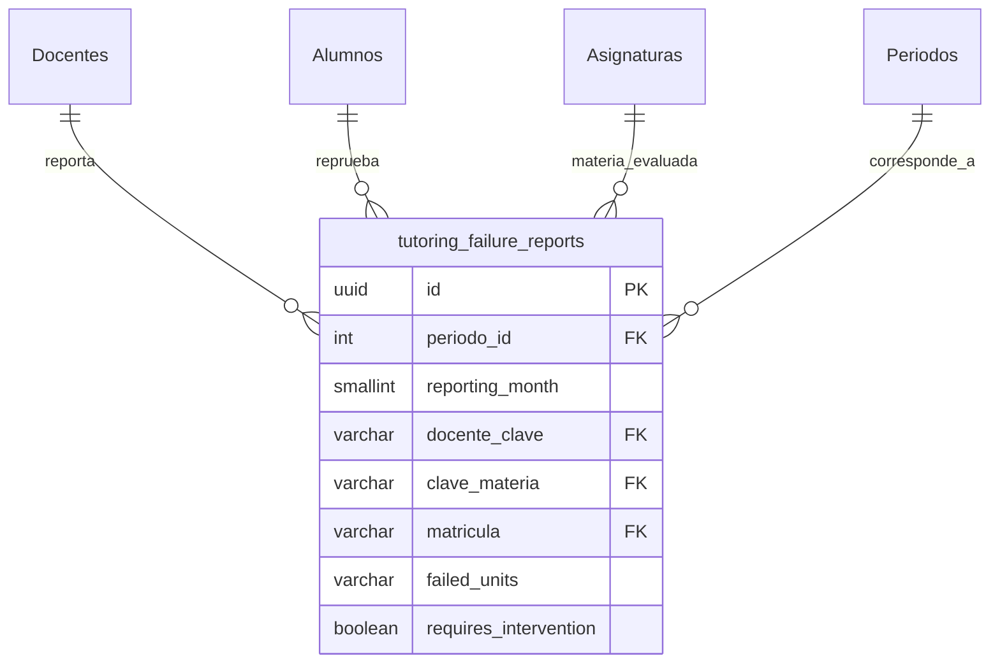

# Especificación de Base de Datos: Módulo de Métricas y Alertas (Metrics)

## 1. Contexto y Objetivo

* **Módulo:** `Metrics` (Métricas e Índices de Reprobación).
* **Objetivo:** Digitalizar la captura mensual del índice de reprobación por materia/alumno, sustituyendo los reportes en Excel. Permitir la generación de métricas comparativas (mes a mes y semestre actual vs. anterior) y detonar alertas tempranas en materias críticas (ej. Cálculo, Dibujo).
* **Estrategia Relacional:** El cálculo del índice base requiere cruzar el total de inscritos (`ListaGrupos`) con las reprobaciones reportadas mensualmente. Se crea la tabla `tutoring_failure_reports` para almacenar la captura granular (unidades reprobadas por mes) de cada docente, manteniendo la pista de auditoría inmutable.

## 2. Diagrama Entidad-Relación (Modelo Extendido)

## 3. Diccionario de Datos: `tutoring_failure_reports`

Implementa los 10 campos de auditoría inmutable (`Soft Delete`).

| Columna | Tipo (PostgreSQL) | Regla / Constraint | Descripción |
| :--- | :--- | :--- | :--- |
| `id` | `uuid` | **PK**, Default `gen_random_uuid()` | Identificador único del reporte de reprobación. |
| `periodo_id` | `int` | **FK** ➜ `Periodos.PeriodoID` | Semestre evaluado. |
| `reporting_month` | `smallint` | `CHECK (1 TO 12)` | Mes calendario de la evaluación (ej. 2 = Febrero). |
| `docente_clave` | `varchar` | **FK** ➜ `Docentes.Clave` | Docente que imparte la materia. |
| `clave_materia` | `varchar` | **FK** ➜ `Asignaturas.ClaveMateria` | Materia evaluada (ej. Cálculo). |
| `matricula` | `varchar` | **FK** ➜ `Alumnos.Matricula` | Estudiante con unidades reprobadas. |
| `failed_units` | `varchar(64)` | `NOT NULL` | Unidades reprobadas en formato separado por comas (ej. `I,III,IV`). |
| `requires_intervention` | `boolean` | `DEFAULT false` | Flag detonado si el caso amerita asesoría urgente. |
| `created_at` | `timestamptz` | `DEFAULT CURRENT_TIMESTAMP` | (Auditoría) Fecha de captura. |
| `created_by` | `varchar(254)` | `NOT NULL` | (Auditoría) Usuario/Docente que capturó. |
| `created_ip` | `varchar(45)` | `NOT NULL` | (Auditoría) IP de origen. |
| `updated_at` | `timestamptz` | `NULLABLE` | (Auditoría) |
| `updated_by` | `varchar(254)` | `NULLABLE` | (Auditoría) |
| `updated_ip` | `varchar(45)` | `NULLABLE` | (Auditoría) |
| `is_deleted` | `boolean` | `DEFAULT false` | (Auditoría - Soft Delete) |
| `deleted_at` | `timestamptz` | `NULLABLE` | (Auditoría) |
| `deleted_by` | `varchar(254)` | `NULLABLE` | (Auditoría) |
| `deleted_ip` | `varchar(45)` | `NULLABLE` | (Auditoría) |

## 4. Reglas de Negocio (Fat Services)

1. **Captura Mensual (Docente):**
   * El endpoint `POST /api/metrics/failures` recibe un arreglo de estudiantes reprobados por grupo.
   * Si un estudiante aprueba todo en ese mes, no se genera registro (optimización de espacio).

2. **Detonador de Alertas Tempranas (Early Warning System):**
   * Durante la inserción, el `MetricsService` calcula el `%` de reprobación del grupo (Total Reprobados / Total en `ListaGrupos`).
   * **Regla:** Si en los meses 1 o 2 del semestre, el índice de reprobación de una asignatura supera el umbral paramétrico (ej. `> 30%`), se marca `requires_intervention = true` y se emite un evento interno para notificar al Coordinador de Turno.

3. **Agregación Comparativa (Dashboard API):**
   * `GET /api/metrics/comparative?targetPeriod={id}&basePeriod={id}`
   * Retorna estructuras DTO agregadas cruzando `tutoring_failure_reports` vs `ListaGrupos`.
   * Permite segmentación por: `TurnoID` (Matutino/Vespertino), `CarreraID` (Sistemas, Industrial, etc.) y `reporting_month`.

4. **Restricción de Ámbito (RBAC):**
   * El *Coordinador General* puede solicitar métricas globales.
   * El *Coordinador de Turno* (`shift_coordinator`) interceptará la consulta inyectando automáticamente un filtro `.Where(m => m.TurnoID == currentUser.Turno)` en la capa de datos.