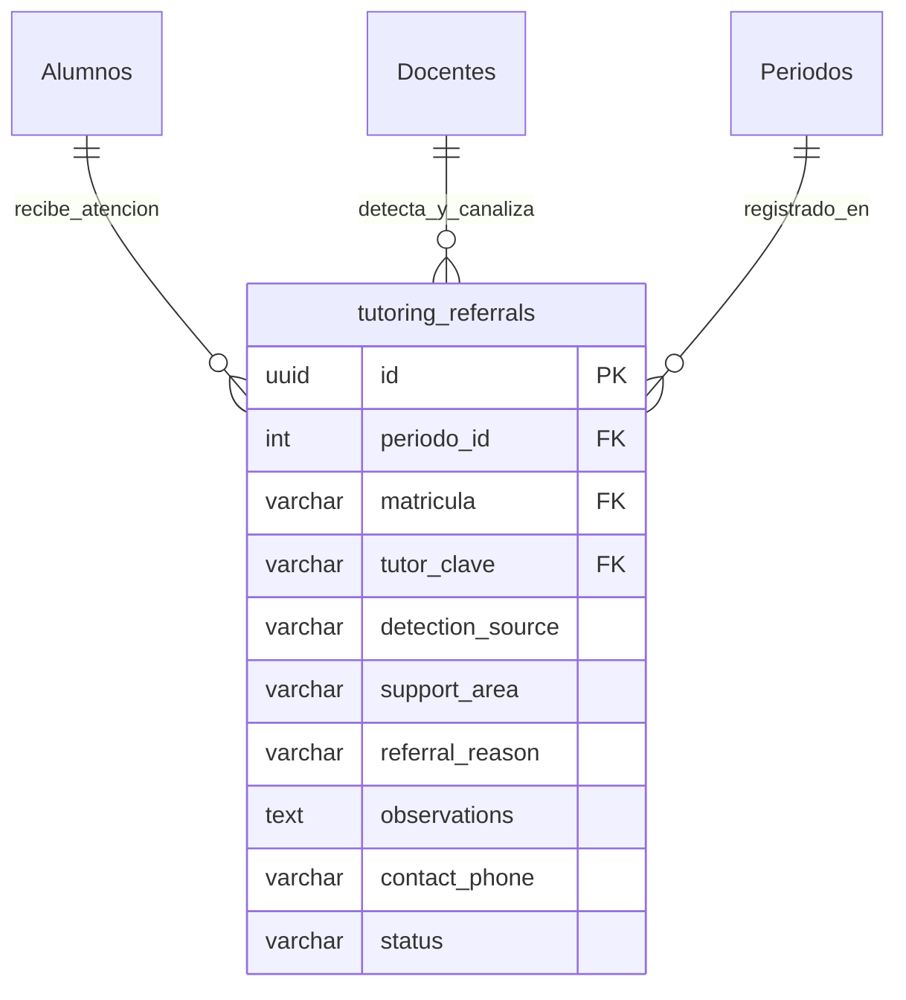

# Especificación de Base de Datos: Módulo de Canalizaciones (Referrals)

## 1. Contexto y Objetivo

* **Módulo:** `Referrals` (Canalizaciones).
* **Objetivo:** Digitalizar el flujo de atención a estudiantes, desde que el tutor o docente detecta una problemática hasta que el área de apoyo correspondiente (Psicología, Enfermería, Trabajo Social) atiende y concluye el caso. 
* **Estrategia Relacional:** Se crea la tabla `tutoring_referrals` para unificar el registro de canalización y el seguimiento, sustituyendo el uso de las tablas *legacy* `FichaCanalizacion/FichaContraReferencia` para este proceso específico, asegurando así el cumplimiento del estándar de auditoría de 10 campos y facilitando las consultas de historial clínico por alumno.

## 2. Diagrama Entidad-Relación (Modelo Extendido)

*(Nota: Datos como Nombre, Carrera, Semestre y Turno no se duplican en esta tabla; se obtienen dinámicamente mediante `JOIN` con las tablas `Alumnos` e `InscritoHistorial` usando la `matricula` y el `periodo_id` para mantener la base de datos normalizada).*

## 3. Diccionario de Datos: `tutoring_referrals`

Incluye la auditoría inmutable y borrado lógico (*Soft Delete*).

| Columna | Tipo (PostgreSQL) | Regla / Constraint | Descripción |
| :--- | :--- | :--- | :--- |
| `id` | `uuid` | **PK**, Default `gen_random_uuid()` | Identificador único de la canalización. |
| `periodo_id` | `int` | **FK** ➜ `Periodos.PeriodoID` | Semestre en el que se realiza la canalización. |
| `matricula` | `varchar` | **FK** ➜ `Alumnos.Matricula` | Identificador del estudiante afectado. |
| `tutor_clave` | `varchar` | **FK** ➜ `Docentes.Clave` | Clave del docente/tutor que registra el caso. |
| `detection_source` | `varchar(32)` | `NOT NULL` | Quién detecta la problemática (`Tutor` o `Maestro`). |
| `support_area` | `varchar(32)` | `NOT NULL` | Área asignada para atención. |
| `referral_reason` | `varchar(32)` | `NOT NULL` | Clasificación del motivo de atención. |
| `observations` | `text` | `NULLABLE` | Descripción detallada del problema o reporte. |
| `contact_phone` | `varchar(20)` | `NULLABLE` | Teléfono de contacto rápido del alumno. |
| `status` | `varchar(16)` | `DEFAULT 'InTracking'` | Estado del caso (`InTracking`, `Resolved`). |
| `created_at` | `timestamptz` | `DEFAULT CURRENT_TIMESTAMP` | (Auditoría) Fecha y hora del reporte inicial. |
| `created_by` | `varchar(254)` | `NOT NULL` | (Auditoría) Usuario que levantó la canalización. |
| `created_ip` | `varchar(45)` | `NOT NULL` | (Auditoría) IP de origen. |
| `updated_at` | `timestamptz` | `NULLABLE` | (Auditoría) Fecha de cierre del caso. |
| `updated_by` | `varchar(254)` | `NULLABLE` | (Auditoría) Personal de apoyo que cerró el caso. |
| `updated_ip` | `varchar(45)` | `NULLABLE` | (Auditoría) IP de modificación. |
| `is_deleted` | `boolean` | `DEFAULT false` | (Auditoría - Soft Delete) Control de borrado. |
| `deleted_at` | `timestamptz` | `NULLABLE` | (Auditoría) Fecha de eliminación. |
| `deleted_by` | `varchar(254)` | `NULLABLE` | (Auditoría) Usuario que eliminó. |
| `deleted_ip` | `varchar(45)` | `NULLABLE` | (Auditoría) IP de eliminación. |

## 4. Catálogos y Constantes de Negocio (Enums de C#)

Para garantizar la integridad de los datos, las columnas de clasificación se restringen a los siguientes Enums en el Backend:

* **`DetectionSource` (detection_source):**
  * `Tutor`
  * `Maestro`
* **`SupportArea` (support_area):**
  * `Psychology` (Psicología)
  * `SocialWork` (Trabajo Social)
  * `Nursing` (Enfermería)
  * `Tutoring` (Tutorías / Nivelación)
* **`ReferralReason` (referral_reason):**
  * `Academic` (Académico)
  * `Emotional` (Emocional)
  * `Personal` (Personales)
  * `Discipline` (Indisciplina)
* **`ReferralStatus` (status):**
  * `InTracking` (En seguimiento)
  * `Resolved` (Terminado)

## 5. Reglas de Negocio (Fat Services)

1. **Creación de Canalización (`POST /api/referrals`):**
   * Validar que el alumno (`matricula`) esté inscrito en el `periodo_id` activo.
   * El caso nace automáticamente con `status = 'InTracking'`.
2. **Aislamiento de Bandeja (RBAC para Áreas de Apoyo):**
   * Cuando un usuario con rol `support_staff` consulta la bandeja de entrada, el servicio extrae los *claims* de su JWT.
   * Se aplica un filtro LINQ obligatorio: `.Where(r => r.SupportArea == currentUser.DepartmentCode)` para garantizar que cada área solo vea sus casos.
3. **Cierre de Caso (`PATCH /api/referrals/{id}/resolve`):**
   * El personal de apoyo invoca este endpoint para cambiar el estado a `Resolved`.
   * Actualiza automáticamente `updated_at` y `updated_by` dejando un sello inmutable.
4. **Consulta de Historial (Tutor / Coordinador):**
   * Al consultar el expediente (`GET /api/referrals/student/{matricula}`), retorna el histórico completo.
   * Si el usuario es rol `tutor`, el servicio verifica primero que el alumno consultado pertenezca a su lista de grupos oficiales.